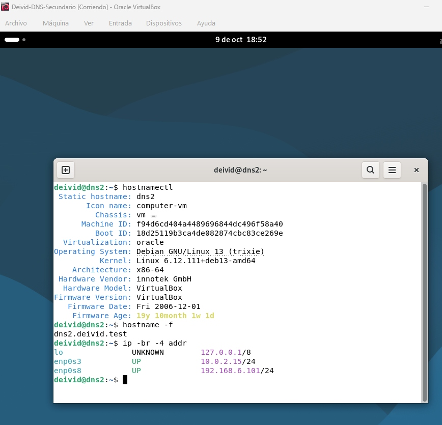
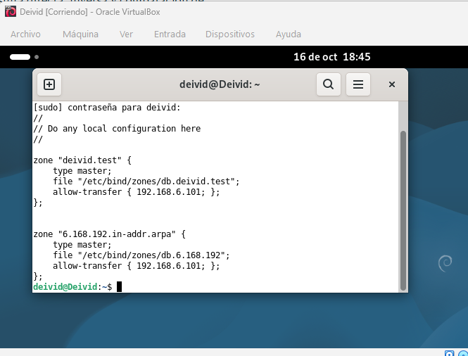
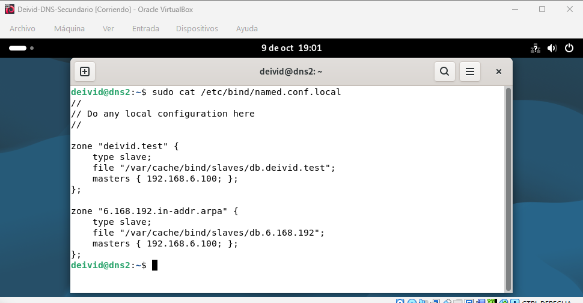
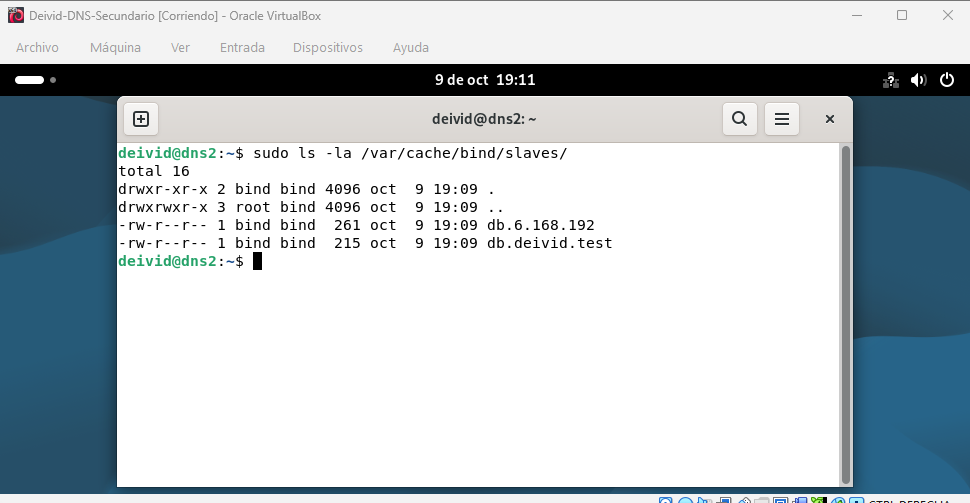
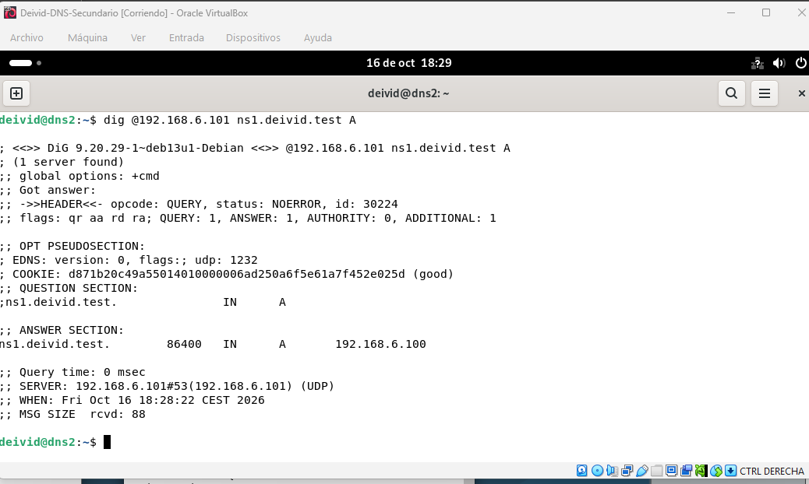
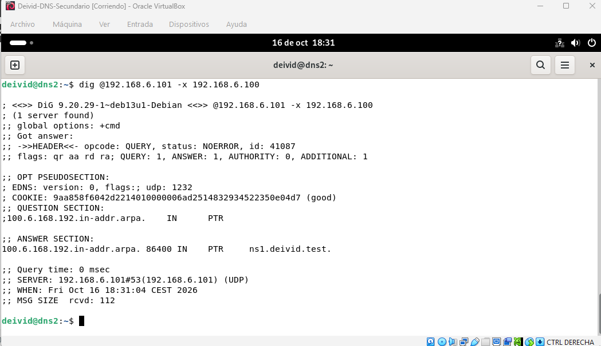
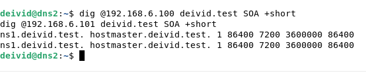
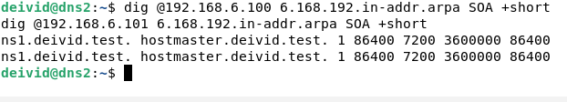

# ACT4 — Configuración de un servidor DNS secundario con BIND9

> Práctica de despliegue de un servidor DNS secundario con BIND9, transferencia de zonas desde un servidor primario y validación de la redundancia del servicio DNS.

## Índice

- [Objetivo](#objetivo)
- [Introducción teórica](#introducción-teórica)
- [Escenario y arquitectura](#escenario-y-arquitectura)
- [Plan de direccionamiento](#plan-de-direccionamiento)
- [Preparación del servidor secundario](#1-preparación-del-servidor-secundario)
- [Configuración del servidor primario](#2-configuración-del-servidor-primario)
- [Configuración del servidor secundario](#3-configuración-del-servidor-secundario)
- [Transferencia y sincronización de zonas](#4-transferencia-y-sincronización-de-zonas)
- [Validación del servicio](#5-validación-del-servicio)
- [Análisis de incidencias técnicas](#análisis-de-incidencias-técnicas)
- [Operación y mantenimiento](#operación-y-mantenimiento)
- [Conclusiones](#conclusiones)
- [Capturas](#capturas)

---

## Objetivo

El objetivo de esta actividad es desplegar un servidor DNS secundario con BIND9 para proporcionar redundancia al servidor DNS primario configurado en la actividad anterior. El secundario recibirá una copia de las zonas directa e inversa mediante transferencia de zona y podrá responder de forma autoritativa a las consultas DNS.

## Introducción teórica

Un servidor DNS secundario, también denominado esclavo, mantiene una copia de las zonas administradas por un servidor primario. Su función principal es aportar disponibilidad y tolerancia a fallos: si el primario no está disponible, los clientes pueden consultar el secundario.

Las transferencias de zona permiten copiar los registros DNS desde el primario al secundario. Una transferencia completa se denomina AXFR y una transferencia incremental se denomina IXFR. El valor serial del registro SOA permite al secundario detectar si la zona del primario ha sido actualizada.

En BIND9, el primario declara una zona con `type master` y autoriza transferencias hacia el secundario mediante `allow-transfer`. El secundario declara esa misma zona con `type slave`, indica la IP del primario en la directiva `masters` y guarda localmente la copia recibida en un directorio escribible por el usuario `bind`.

## Escenario y arquitectura

El servidor primario administra las zonas `deivid.test` y `6.168.192.in-addr.arpa`. El secundario utiliza la interfaz `enp0s8`, con IP `192.168.6.101/24`, para comunicarse con la red de laboratorio. Estos datos se han confirmado mediante la salida de `ip -4 -br addr`.

```text
Red de laboratorio: 192.168.6.0/24

DNS primario                            DNS secundario
ns1.deivid.test.                         ns2.deivid.test.
192.168.6.100  ── transferencia ───────▶ 192.168.6.101
BIND9: type master                      BIND9: type slave
```

## Plan de direccionamiento

| Elemento | Valor |
|---|---|
| Red de laboratorio | `192.168.6.0/24` |
| DNS primario | `ns1.deivid.test.` |
| IP del primario | `192.168.6.100` |
| DNS secundario previsto en el diseño | `ns2.deivid.test.` |
| Hostname observado del secundario | `dns2` |
| Interfaz de laboratorio del secundario | `enp0s8` |
| IP del secundario | `192.168.6.101/24` |
| Otra interfaz del secundario | `enp0s3`, con `10.0.2.15/24` |
| Zona directa | `deivid.test` |
| Zona inversa | `6.168.192.in-addr.arpa` |

## 1. Preparación del servidor secundario

En la segunda máquina virtual Debian se comprueban el hostname, las interfaces y las rutas:

```bash
hostnamectl
ip -4 addr show
ip route
```

### Hostname del servidor DNS2



La comprobación posterior de las interfaces devuelve:

```text
lo       UNKNOWN  127.0.0.1/8
enp0s3   UP       10.0.2.15/24
enp0s8   UP       192.168.6.101/24
```

Para instalar y habilitar BIND9, si todavía no está instalado:

```bash
sudo apt update
sudo apt install bind9 bind9utils dnsutils
sudo systemctl enable --now bind9
sudo systemctl status bind9
```

## 2. Configuración del servidor primario

Se comprobó la configuración del primario mediante:

```bash
sudo cat /etc/bind/named.conf.local
```

El archivo contiene las dos zonas como `type master` y autoriza las transferencias a `192.168.6.101`:

```conf
zone "deivid.test" {
    type master;
    file "/etc/bind/zones/db.deivid.test";
    allow-transfer { 192.168.6.101; };
};

zone "6.168.192.in-addr.arpa" {
    type master;
    file "/etc/bind/zones/db.6.168.192";
    allow-transfer { 192.168.6.101; };
};
```

### Autorización de transferencia en el maestro

La configuración permite que el secundario `192.168.6.101` solicite las zonas directa e inversa. El archivo real no incluye `also-notify`; el bloque anterior reproduce la configuración compartida del maestro.



En la zona directa, los registros previstos para los servidores son:

```dns
@       IN  NS  ns1.deivid.test.
@       IN  NS  ns2.deivid.test.
ns1     IN  A   192.168.6.100
ns2     IN  A   192.168.6.101
```

En la zona inversa, el PTR previsto para el secundario es:

```dns
101     IN  PTR ns2.deivid.test.
```

Estos registros de `ns2` deben verificarse en los archivos reales; las consultas documentadas más adelante comprueban el registro de `ns1`, no el de `ns2`.

Después de modificar una zona se debe incrementar su serial SOA, validar los archivos y recargar BIND9:

```bash
sudo named-checkconf
sudo named-checkzone deivid.test /etc/bind/zones/db.deivid.test
sudo named-checkzone 6.168.192.in-addr.arpa /etc/bind/zones/db.6.168.192
sudo rndc reload
```

## 3. Configuración del servidor secundario

El secundario no crea manualmente los archivos de zona: los recibe desde el primario. Se prepara un directorio donde BIND9 pueda almacenar las transferencias:

```bash
sudo mkdir -p /var/cache/bind/slaves
sudo chown bind:bind /var/cache/bind/slaves
```

Configuración de referencia en `/etc/bind/named.conf.local`:

```conf
zone "deivid.test" {
    type slave;
    masters { 192.168.6.100; };
    file "/var/cache/bind/slaves/db.deivid.test";
};

zone "6.168.192.in-addr.arpa" {
    type slave;
    masters { 192.168.6.100; };
    file "/var/cache/bind/slaves/db.6.168.192";
};
```

### Configuración del servidor esclavo



En `/etc/bind/named.conf.options` de DNS2 se corrigió la dirección de escucha:

```conf
listen-on { 127.0.0.1; 192.168.6.101; };
```

La dirección de `listen-on` corresponde al propio DNS2. En cambio, `masters { 192.168.6.100; };` sigue señalando al primario y no se cambia por la IP del esclavo.

Se validó la configuración y se reinició el servicio:

```bash
sudo named-checkconf /etc/bind/named.conf && sudo systemctl restart named
```

## 4. Transferencia y sincronización de zonas

Tras iniciar BIND9 en el secundario, este solicita las zonas al primario. Para comprobar los archivos y registros del servicio:

```bash
sudo ls -la /var/cache/bind/slaves/
sudo journalctl -u bind9 -n 50 --no-pager
```

### Transferencia de zonas



Las consultas siguientes documentan por separado las respuestas del secundario y la comparación de los registros SOA.

## 5. Validación del servicio

Las pruebas se ejecutaron desde la terminal de `dns2`.

### Consulta directa al servidor esclavo

```bash
dig @192.168.6.101 ns1.deivid.test A
```

La respuesta devuelve `status: NOERROR`, el indicador autoritativo `aa` y un registro `A` con `ns1.deivid.test. → 192.168.6.100`. La línea `SERVER` identifica al secundario `192.168.6.101#53`.



### Consulta inversa al servidor esclavo

```bash
dig @192.168.6.101 -x 192.168.6.100
```

La respuesta devuelve `status: NOERROR`, el indicador `aa` y un registro PTR que asocia `192.168.6.100` con `ns1.deivid.test.`. Responde el secundario `192.168.6.101`.



### Comparación del SOA de la zona directa

```bash
dig @192.168.6.100 deivid.test SOA +short
dig @192.168.6.101 deivid.test SOA +short
```

Ambos servidores devuelven:

```text
ns1.deivid.test. hostmaster.deivid.test. 1 86400 7200 3600000 86400
```

El serial anunciado para la zona directa es `1` en ambos servidores.



### Comparación del SOA de la zona inversa

```bash
dig @192.168.6.100 6.168.192.in-addr.arpa SOA +short
dig @192.168.6.101 6.168.192.in-addr.arpa SOA +short
```

Ambos servidores devuelven:

```text
ns1.deivid.test. hostmaster.deivid.test. 1 86400 7200 3600000 86400
```

El serial anunciado para la zona inversa también es `1` en ambos servidores.



Estas comprobaciones confirman las respuestas autoritativas del esclavo para los registros consultados y la coincidencia de los SOA de ambas zonas. No constituyen una prueba de funcionamiento con el maestro detenido, que todavía no se ha realizado.

## Análisis de incidencias técnicas

### Consulta rechazada por una dirección de escucha incorrecta

Al consultar `192.168.6.101`, `dig` mostró `connection refused`. La salida de `ss` indicó que `named` estaba escuchando únicamente en `127.0.0.1:53`.

El archivo de opciones de DNS2 contenía:

```conf
listen-on { 127.0.0.1; 192.168.6.100; };
```

La segunda dirección era la del maestro, no la del servidor local. Se guardó una copia de seguridad, se sustituyó por `192.168.6.101`, se validó la sintaxis y se reinició `named`. La consulta posterior respondió correctamente con `NOERROR` y `aa`.

### Otros problemas a comprobar si falla una transferencia

- El primario no autoriza la IP del secundario en `allow-transfer`.
- El secundario no puede escribir en `/var/cache/bind/slaves/`.
- El puerto TCP 53 está bloqueado.
- El serial SOA no se ha incrementado después de modificar una zona.
- El secundario no tiene conectividad con `192.168.6.100`.
- La zona en el secundario tiene una IP errónea en `masters`.

Para diagnosticar estos casos:

```bash
sudo named-checkconf
sudo systemctl status named --no-pager -l
sudo journalctl -u named -n 50 --no-pager
sudo ss -lntup | grep ':53'
```

## Operación y mantenimiento

Después de modificar una zona en el primario:

1. Incrementar el serial del SOA.
2. Validar el archivo de zona con `named-checkzone`.
3. Recargar BIND9 en el primario con `sudo rndc reload`.
4. Comprobar en el secundario que recibe la actualización.
5. Consultar el SOA en ambos servidores para verificar que muestran el mismo serial.

## Conclusiones

El secundario `192.168.6.101` responde de forma autoritativa a las consultas directa e inversa realizadas para `ns1.deivid.test`. Los SOA consultados coinciden con los del primario para las zonas directa e inversa, con serial `1`. Se corrigió una dirección de escucha incorrecta en DNS2 que impedía recibir consultas en la interfaz de laboratorio.

La configuración compartida del maestro autoriza al secundario a transferir ambas zonas. No se ha realizado todavía una prueba con el primario detenido.

## Capturas

Todas las capturas se guardan en `evidencias/`.

| Nº | Descripción | Captura |
|---:|---|---|
| 1 | Hostname del servidor DNS2 | [Ver captura](evidencias/01-hostname-dns2.png) |
| 2 | Configuración del servidor esclavo | [Ver captura](evidencias/02-configuracion-esclavo.png) |
| 3 | Autorización de transferencia en el maestro | [Ver captura](evidencias/03-autorizacion-transferencia-maestro.png) |
| 4 | Transferencia de zonas | [Ver captura](evidencias/04-transferencia-zonas.png) |
| 5 | Consulta directa al esclavo | [Ver captura](evidencias/05-consulta-directa-esclavo.png) |
| 6 | Consulta inversa al esclavo | [Ver captura](evidencias/06-consulta-inversa-esclavo.png) |
| 7 | Comparación del SOA de la zona directa | [Ver captura](evidencias/07-comparacion-soa-directa.png) |
| 8 | Comparación del SOA de la zona inversa | [Ver captura](evidencias/08-comparacion-soa-inversa.png) |
