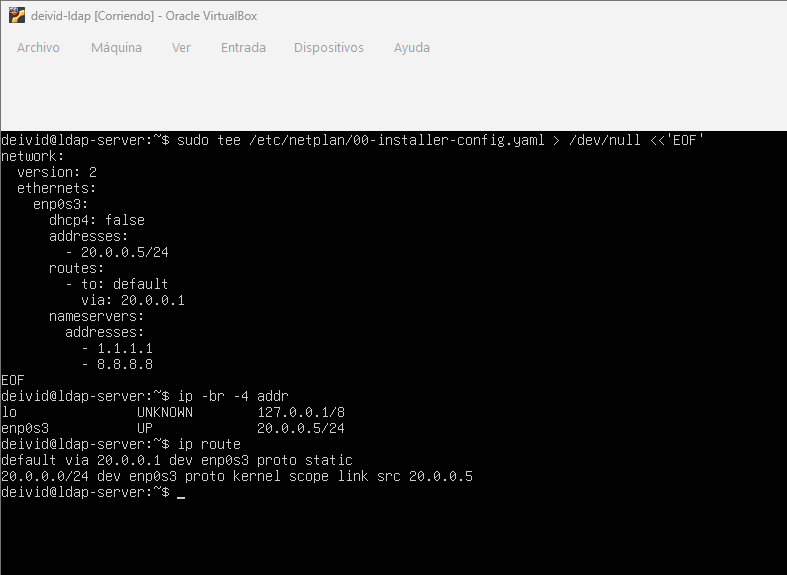
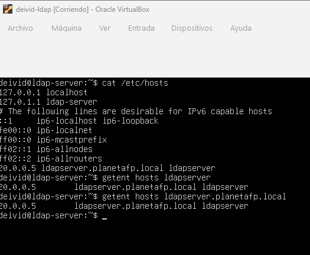
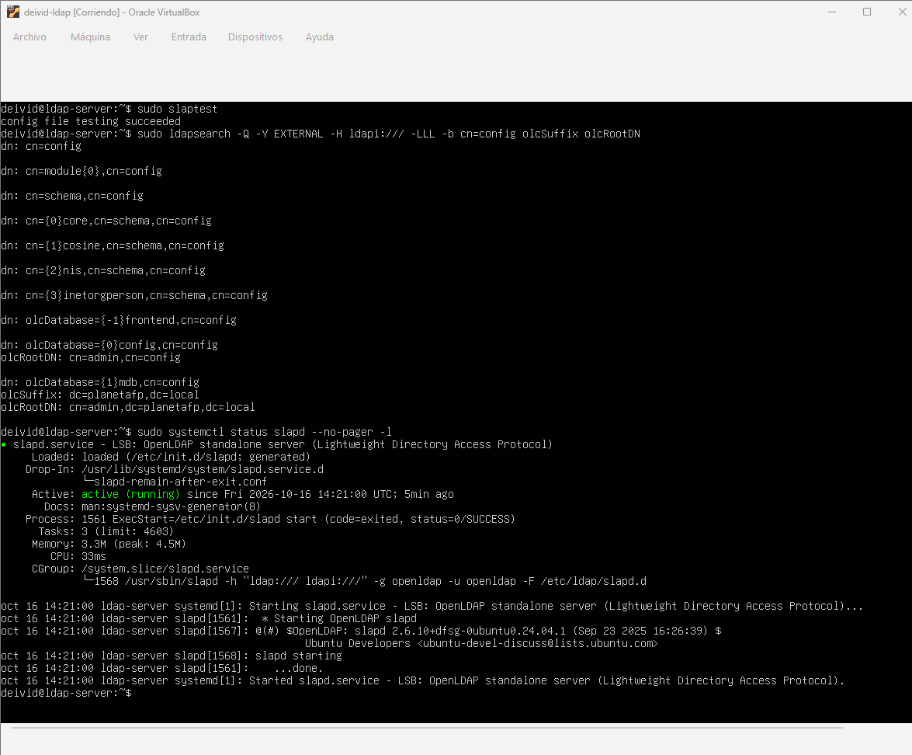
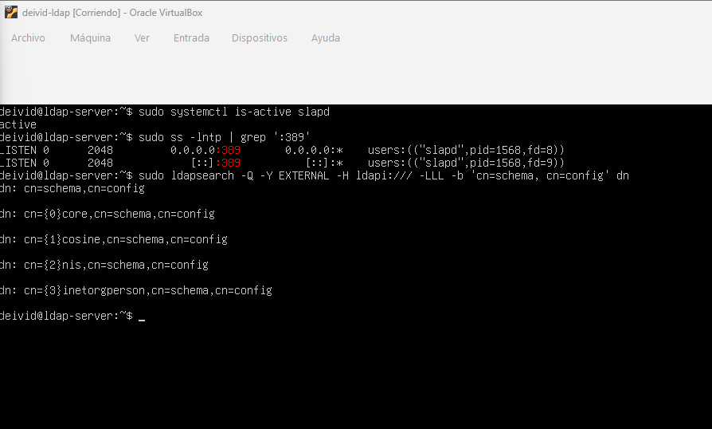
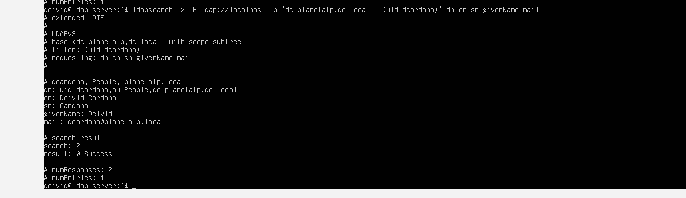

# ACT5 — Instalación y configuración de OpenLDAP

> Playbook de despliegue técnico para instalar, configurar y verificar un
> servicio de directorio OpenLDAP en una máquina virtual.

## Índice

- [A. Ficha técnica y prerrequisitos](#a-ficha-técnica-y-prerrequisitos-del-entorno)
- [B. Procedimiento de despliegue](#b-procedimiento-de-despliegue-paso-a-paso)
- [C. Verificación y comprobación](#c-verificación-y-comprobación)
- [D. Población y operaciones básicas](#d-población-del-directorio-y-operaciones-básicas)
- [E. Control de errores](#e-control-de-errores-y-troubleshooting)
- [Evidencias](#evidencias)

---

## A. Ficha técnica y prerrequisitos del entorno

### Objetivo general

Instalar, configurar y poner en marcha OpenLDAP en un entorno virtualizado. Este documento sirve como guía operativa para desplegar el servicio, comprobar su funcionamiento, cargar una estructura inicial en el directorio y realizar consultas básicas.

### Ficha técnica

| Parámetro | Valor |
|---|---|
| Entorno de virtualización | VirtualBox |
| Red | NAT sin DHCP |
| Sistema operativo | Ubuntu Server con Netplan — pendiente de confirmar versión |
| Dirección IP estática | `20.0.0.5/24` |
| Puerta de enlace | Pendiente de confirmar según la red NAT configurada |
| FQDN | `ldapserver.planetafp.local` |
| Alias local | `ldapserver` |
| Dominio LDAP | `planetafp.local` |
| Base DN | `dc=planetafp,dc=local` |
| Organización | `planetafp` |
| Paquetes requeridos | `slapd`, `ldap-utils` |

### Componentes del servicio

- `slapd` es el daemon de OpenLDAP. Atiende las conexiones LDAP y administra la base de datos del directorio.
- `ldap-utils` proporciona herramientas de administración y consulta, entre ellas `ldapadd` y `ldapsearch`.
- `libldap` es la biblioteca cliente LDAP utilizada por aplicaciones y utilidades para establecer comunicación con el servidor.
- El DIT (*Directory Information Tree*) es la estructura jerárquica del directorio. En esta práctica parte de `dc=planetafp,dc=local`.

### Prerrequisitos

- Disponer de una máquina virtual con acceso de administración mediante `sudo`.
- Configurar el adaptador de VirtualBox como red NAT sin DHCP.
- Identificar el nombre real de la interfaz con `ip -br link`; en los ejemplos se utiliza `enp0s3`, que debe cambiarse si tu interfaz tiene otro nombre.
- Tener conectividad con los repositorios de paquetes antes de iniciar la instalación.

---

## B. Procedimiento de despliegue paso a paso

### Paso 1. Configuración de red estática

Comprueba el nombre de interfaz y los archivos de Netplan:

```bash
ip -br link
ls -l /etc/netplan/
```

Edita el archivo YAML de Netplan —por ejemplo, `/etc/netplan/01-netcfg.yaml`— y sustituye `enp0s3` si tu interfaz tiene otro nombre:

```yaml
network:
  version: 2
  ethernets:
    enp0s3:
      dhcp4: false
      addresses:
        - 20.0.0.5/24
      routes:
        - to: default
          via: PENDIENTE_PUERTA_DE_ENLACE
      nameservers:
        addresses:
          - 1.1.1.1
          - 8.8.8.8
```

> Sustituye `PENDIENTE_PUERTA_DE_ENLACE` por la puerta de enlace real de la red NAT. No se debe aplicar un valor supuesto.

Valida y aplica la configuración:

```bash
sudo netplan try
sudo netplan apply
ip -4 addr show
ip route
```

**Evidencia prevista:** captura de `ip -4 addr show` e `ip route` donde aparezca `20.0.0.5/24`.



### Paso 2. Resolución de nombres local

Edita `/etc/hosts` y añade esta línea:

```text
20.0.0.5   ldapserver.planetafp.local ldapserver
```

Comprueba el contenido del archivo y la resolución local:

```bash
cat /etc/hosts
getent hosts ldapserver
getent hosts ldapserver.planetafp.local
```

La entrada permite que el servidor se identifique mediante su FQDN sin depender de un DNS externo y evita errores de resolución durante las pruebas del servicio.

**Evidencia 2 completada:** configuración de `/etc/hosts` y comprobación de la resolución local. La captura muestra la entrada del servidor y confirma que tanto el alias `ldapserver` como el nombre completo `ldapserver.planetafp.local` resuelven a `20.0.0.5`.



### Paso 3. Instalación de software

Actualiza los repositorios e instala OpenLDAP y las utilidades de administración:

```bash
sudo apt update
sudo apt install -y slapd ldap-utils
```

Durante la instalación inicial puede solicitarse una contraseña para el administrador LDAP. Si necesitas revisar la configuración, utiliza el siguiente paso.

### Paso 4. Reconfiguración del servicio

Ejecuta el asistente de reconfiguración:

```bash
sudo dpkg-reconfigure slapd
```

Registra estas respuestas:

| Pregunta | Respuesta |
|---|---|
| ¿Omitir la configuración del servidor OpenLDAP? | `No` |
| Nombre de dominio DNS | `planetafp.local` |
| Nombre de la organización | `planetafp` |
| Contraseña del administrador | Una contraseña segura; no publicarla en GitHub |
| Confirmar contraseña | Repetir la contraseña |
| Motor de base de datos | `MDB` |
| ¿Eliminar la base de datos al purgar slapd? | `No` |
| ¿Mover la base de datos antigua? | `Sí`, si existe una base previa y el asistente lo solicita |

Valida la configuración y reinicia el servicio:

```bash
sudo slaptest
sudo systemctl restart slapd
sudo systemctl status slapd --no-pager
```

Consulta la base del directorio y su administrador en la configuración local:

```bash
sudo ldapsearch -Q -Y EXTERNAL -H ldapi:/// -LLL -b cn=config olcSuffix olcRootDN
```

**Evidencia 3 completada:** validación de la configuración y estado del servicio OpenLDAP. La salida obtenida confirma `config file testing succeeded`, la base `olcSuffix: dc=planetafp,dc=local`, el administrador `olcRootDN: cn=admin,dc=planetafp,dc=local` de la base MDB y el estado `active (running)` del servicio `slapd`.



---

## C. Verificación y comprobación

Comprueba que el servicio está habilitado y en ejecución:

```bash
sudo systemctl is-enabled slapd
sudo systemctl is-active slapd
sudo systemctl status slapd --no-pager
```

Comprueba el puerto LDAP estándar:

```bash
sudo ss -lntp | grep ':389'
```

Comprueba que existen esquemas en la base de configuración:

```bash
sudo ldapsearch -Y EXTERNAL -H ldapi:/// \
  -b cn=schema,cn=config -LLL dn
```

La salida debe mostrar entradas bajo `cn=schema,cn=config`, normalmente con esquemas como `core`, `cosine`, `nis` e `inetorgperson`.

### Evidencia 4 — Servicio, puerto y esquemas LDAP

En las comprobaciones realizadas, `slapd` devuelve `enabled` y `active`, el puerto TCP `389` aparece en estado `LISTEN` para IPv4 e IPv6 y la consulta de esquemas devuelve `core`, `cosine`, `nis` e `inetorgperson` bajo `cn=schema,cn=config`.



Comprueba la entrada base del DIT con autenticación simple:

```bash
ldapsearch -x -H ldap://localhost \
  -D 'cn=admin,dc=planetafp,dc=local' -W \
  -b 'dc=planetafp,dc=local' -s base '(objectClass=*)'
```

La opción `-W` pide la contraseña de forma interactiva; no la muestra ni la guarda en el historial.

---

## D. Población del directorio y operaciones básicas

### Archivo LDIF de prueba

La estructura inicial contiene una unidad organizativa y un usuario:

```ldif
dn: ou=People,dc=planetafp,dc=local
objectClass: top
objectClass: organizationalUnit
ou: People
description: Unidad organizativa para usuarios del directorio

dn: uid=dcardona,ou=People,dc=planetafp,dc=local
objectClass: top
objectClass: person
objectClass: organizationalPerson
objectClass: inetOrgPerson
cn: Deivid Cardona
sn: Cardona
givenName: Deivid
uid: dcardona
mail: dcardona@planetafp.local
userPassword: HASH_GENERADO_LOCALMENTE
```

> Este bloque es una plantilla: sustituye `HASH_GENERADO_LOCALMENTE` por el hash generado con `slappasswd` únicamente en la copia local. No publiques contraseñas ni hashes reales en GitHub.

En el servidor se creó `~/estructura-inicial.ldif` con permisos restringidos mediante `umask 077`. Se generó el hash con `LDAP_HASH=$(slappasswd)` y se incorporó al archivo local. Después se eliminó la variable con `unset LDAP_HASH`. El archivo del servidor no debe confundirse con la plantilla guardada en `archivos/` del repositorio.

### Inserción con ldapadd

Desde el directorio personal del servidor se ejecutó:

```bash
ldapadd -x -H ldap://localhost -D 'cn=admin,dc=planetafp,dc=local' -W -f estructura-inicial.ldif
```

La salida compartida confirmó las dos altas:

```text
adding new entry "ou=People,dc=planetafp,dc=local"

adding new entry "uid=dcardona,ou=People,dc=planetafp,dc=local"
```

No es necesario repetir este comando si las entradas ya existen. Esta salida documenta la inserción; la captura de la Evidencia 5 corresponde a la consulta posterior, no al alta.

### Evidencia 5 — Consulta general del directorio LDAP

En la consola de Ubuntu se ejecutó:

```bash
ldapsearch -x -H ldap://localhost -b 'dc=planetafp,dc=local' '(objectClass=*)'
```

La consulta muestra las tres entradas del directorio: la raíz del dominio, la unidad organizativa `People` y el usuario `dcardona`. La operación finaliza correctamente con `result: 0 Success` y `numEntries: 3`.

```text
dc=planetafp,dc=local
└── ou=People
    └── uid=dcardona
```


### Evidencia 6 — Consulta específica del usuario dcardona

En la consola de Ubuntu se ejecutó:

```bash
ldapsearch -x -H ldap://localhost -b 'dc=planetafp,dc=local' '(uid=dcardona)' dn cn sn givenName mail
```

Se realiza una consulta LDAP utilizando el filtro `(uid=dcardona)` sobre la base `dc=planetafp,dc=local`. El resultado muestra una única entrada con el DN, nombre completo, apellido, nombre de pila y correo electrónico del usuario. La búsqueda finaliza correctamente con `result: 0 Success` y `numEntries: 1`.

La salida compartida confirma los siguientes datos:

```text
dn: uid=dcardona,ou=People,dc=planetafp,dc=local
cn: Deivid Cardona
sn: Cardona
givenName: Deivid
mail: dcardona@planetafp.local
```

El atributo solicitado es `givenName`, no `giveName`. Se conserva la salida extendida, sin `-LLL`, para mostrar también el resultado de la operación y el número de entradas.



### Comprobación de autenticación

También se comprobó la contraseña LDAP del usuario mediante:

```bash
ldapwhoami -x -H ldap://localhost -D 'uid=dcardona,ou=People,dc=planetafp,dc=local' -W
```

La salida obtenida fue:

```text
dn:uid=dcardona,ou=People,dc=planetafp,dc=local
```

Esto confirma la autenticación como `dcardona`; no debe confundirse con una consulta de atributos ni con un inicio de sesión del sistema operativo. La contraseña utilizada es la del usuario LDAP, no la del administrador LDAP ni la de acceso a Ubuntu.

**Evidencia 7 pendiente de captura:** autenticación con `ldapwhoami`. La prueba ya funcionó según la salida compartida, pero todavía no tiene imagen enlazada en este documento.

---

## E. Control de errores y troubleshooting

| Problema | Causa habitual | Diagnóstico | Solución |
|---|---|---|---|
| `ldap_add: Invalid syntax (21)` | Atributo obligatorio ausente, DN incorrecto o LDIF mal formado | Revisar la entrada indicada por el error | Corregir el DN, los `objectClass`, los atributos obligatorios y comprobar que las entradas están separadas por una línea en blanco |
| `ldap_bind: Invalid credentials (49)` | Contraseña o DN de autenticación incorrectos | Revisar el DN y probar el bind con `-W` | Usar la contraseña correspondiente al DN indicado; no confundir administrador LDAP, usuario LDAP y usuario de Ubuntu. Si persiste, comprobar el DN configurado antes de restablecer credenciales |
| No se resuelve `ldapserver` | Entrada ausente o errónea en `/etc/hosts` | Ejecutar `getent hosts ldapserver` | Corregir o añadir `20.0.0.5 ldapserver.planetafp.local ldapserver` |
| `ldap_connect: Can't contact LDAP server (-1)` | Servicio detenido, URI incorrecta o puerto sin escucha | Ejecutar `systemctl status slapd` y `ss -lntp \| grep ':389'` | Reiniciar `slapd`, revisar que escucha en TCP 389 y utilizar `ldap://localhost` o el FQDN correcto |
| `ldap_add: Already exists (68)` | La entrada ya fue cargada | Buscar el DN con `ldapsearch` | No repetir el alta; modificar la entrada con `ldapmodify` o eliminarla de forma controlada antes de recrearla |

---

## Evidencias

| Nº | Evidencia | Captura |
|---:|---|---|
| 1 | IP estática configurada con Netplan | [Ver captura](evidencias/01-ip-estatica-netplan.png) |
| 2 | Configuración de /etc/hosts y resolución local | [Ver captura](evidencias/Evidencia_2_Resolucion_nombre_LDAP.jpg) |
| 3 | Validación de la configuración y estado del servicio OpenLDAP | [Ver captura](evidencias/03-configuracion-slapd.png) |
| 4 | Verificación del servicio, puerto LDAP y esquemas | [Ver captura](evidencias/04-servicio-puerto-esquemas.png) |
| 5 | Consulta general del directorio LDAP | [Ver captura](evidencias/5.%20Consulta%20general%20del%20directorio%20LDAP.jpg) |
| 6 | Consulta específica del usuario dcardona | [Ver captura](evidencias/06-consulta-usuario-dcardona.png) |
| 7 | Autenticación LDAP del usuario dcardona | Pendiente de captura |
